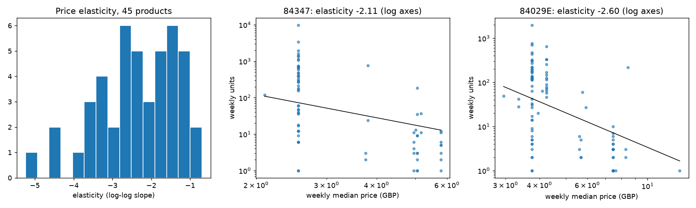
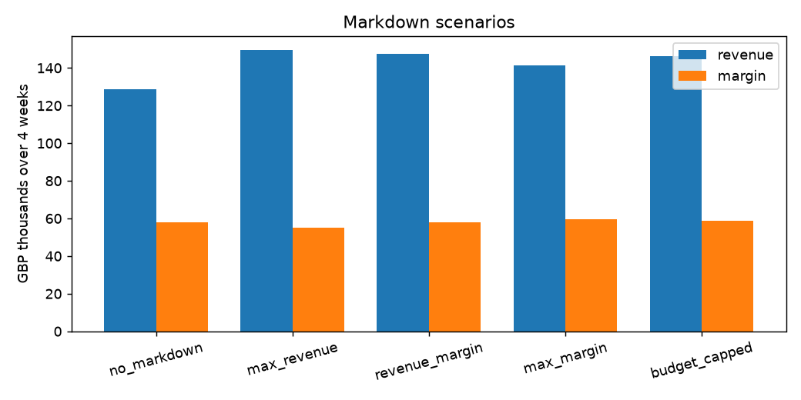

# Price Elasticity and Markdown Optimization

How much does demand for each product respond to its price, and given that, which markdowns should a retailer run?

**Data:** two years of invoice lines from a UK online gift retailer (UCI Online Retail II, about 1 million lines). Aggregated to a weekly price/quantity panel for the 60 highest-revenue products that were sold in at least 40 weeks at 5 or more distinct prices.

## 1. Elasticity per product

For each product, a log-log regression of weekly units on weekly median price, with month effects and a trend, gives the price elasticity (the % change in units for a 1% change in price). Robust standard errors.

- 75% of the 60 products have a significantly negative elasticity (p < 0.05).
- 45 products pass the filter used downstream (significant, between -6 and -0.2).
- Median elasticity -2.30 (interquartile range -3.07 to -1.44); median R² 0.41.

Best-fitting examples:

| SKU | Product | Elasticity | R² |
|---|---|---|---|
| 22910 | Paper Chain Kit Vintage Christmas | -3.18 | 0.93 |
| 22086 | Paper Chain Kit 50'S Christmas | -2.04 | 0.82 |
| 84029E | Red Woolly Hottie White Heart. | -2.60 | 0.82 |
| 21485 | Retrospot Heart Hot Water Bottle | -1.77 | 0.81 |
| 84029G | Knitted Union Flag Hot Water Bottle | -0.70 | 0.78 |



These are large elasticities. Part of that is real (cheap gift items are very price-sensitive); part is the data: the retailer sells to both consumers and trade buyers, and weekly median price moves partly because the customer mix changes, not only because the list price changes. Treat the numbers as the observed response of weekly units to weekly price, not as clean causal estimates. The optimization below only needs the ranking and rough magnitude.

## 2. Markdown plan as a mixed-integer program

Each of the 45 usable products gets exactly one markdown depth from 0%, 10%, 20%, 30%, 40% for a 4-week window. Predicted units at depth d follow the fitted curve, units × (1 − d)^elasticity. Revenue, margin and discount cost per (product, depth) are precomputed, so the choice is a binary linear program solved with PuLP/CBC in under a second.

Assumptions, stated because the data has neither costs nor stock levels: unit cost = 55% of list price; inventory on hand = 6 weeks of baseline demand; markdown budget = 10% of baseline revenue. All three are parameters at the top of `src/optimize.py`.

| Scenario | Revenue (GBP) | Margin (GBP) | Units | Products marked down | Avg depth |
|---|---|---|---|---|---|
| no markdown | 128,853 | 57,984 | 42,746 | 0 | 0% |
| max revenue | 149,342 | 55,099 | 56,981 | 40 | 13% |
| revenue margin | 147,696 | 57,993 | 53,728 | 32 | 8% |
| max margin | 141,193 | 59,671 | 49,019 | 18 | 4% |
| budget capped | 146,303 | 58,749 | 52,592 | 29 | 7% |

Reading the table: maximizing revenue alone discounts almost everything, gives up margin, and runs 43 products into their inventory cap. Adding a margin floor ("revenue margin") keeps margin at least at the no-markdown level and still lifts revenue +14.6% (margin unchanged; 32 products at their inventory cap). The budget-capped run shows what a fixed promotion budget buys.

Top rows of the recommended plan (revenue-max with the margin floor):

| SKU | Product | List price | Elasticity | Depth | Units | Revenue |
|---|---|---|---|---|---|---|
| 22086 | Paper Chain Kit 50'S Christmas | 2.95 | -2.04 | 10% | 5,769 | 15,316 |
| 85099B | Jumbo Bag Red Retrospot | 2.08 | -2.63 | 10% | 6,051 | 11,327 |
| 22910 | Paper Chain Kit Vintage Christmas | 2.95 | -3.18 | 10% | 3,383 | 8,982 |
| 79321 | Chilli Lights | 5.75 | -3.38 | 10% | 1,668 | 8,633 |
| 22114 | Hot Water Bottle Tea And Sympathy | 4.25 | -1.80 | 20% | 1,947 | 6,620 |
| 84347 | Rotating Silver Angels T-Light Hldr | 2.55 | -2.11 | 10% | 2,534 | 5,816 |
| 21137 | Black Record Cover Frame | 3.75 | -4.35 | 0% | 1,542 | 5,784 |
| 22112 | Chocolate Hot Water Bottle | 4.95 | -1.27 | 0% | 1,045 | 5,173 |



## How it works

```
data/download.py     fetch the workbook, cache as parquet (not committed)
src/prepare.py       clean, build the weekly panel, pick the products
src/elasticity.py    log-log OLS per product with month and trend controls; results/elasticities.csv
src/optimize.py      candidate table, five MILP scenarios; results/scenarios.csv, results/markdown_plan.csv
src/report.py        render this README from results/metrics.json
notebooks/01_analysis.ipynb   the same steps with the intermediate tables shown
```

## Run it

```bash
python -m venv .venv && source .venv/bin/activate
pip install -r requirements.txt
./run_all.sh
```

About three minutes, most of it reading the Excel workbook once. Every number above is read from `results/metrics.json`, which the run regenerates.

Data: [Online Retail II](https://archive.ics.uci.edu/dataset/502/online+retail+ii), UCI Machine Learning Repository (CC BY 4.0).
